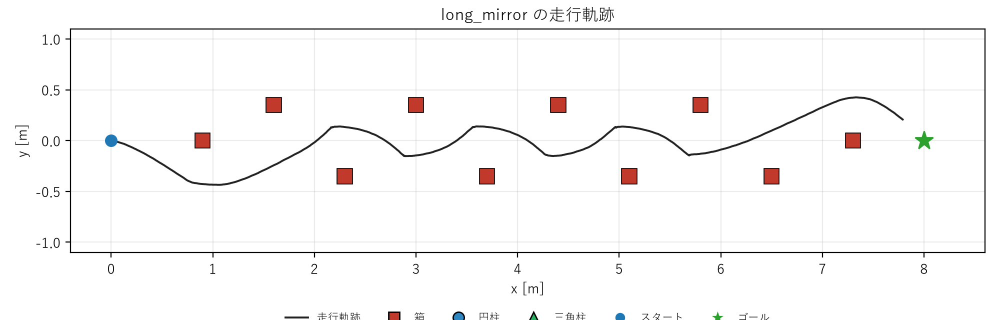
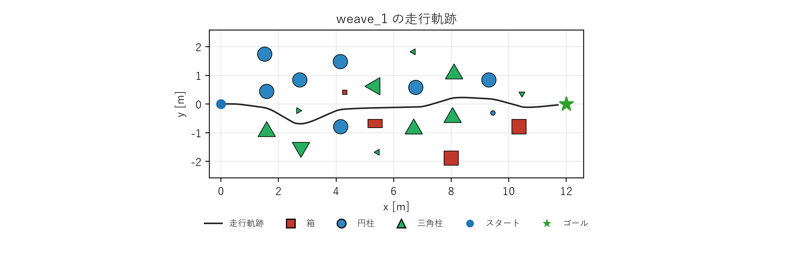
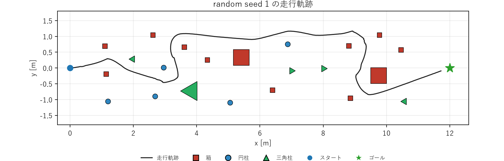

# Go2 四足ロボットの障害物回避歩行（Genesis）

Genesis 上の四足ロボット Unitree Go2 が、**深度カメラの情報だけ**を使って、床に置かれた障害物（箱・円柱・三角柱、大小）を避けながらゴールへ向かうデモです。脚の動きは学習済みの歩行ポリシー（強化学習）が担当し、その上に載せる「深度から速度指令を出す制御」を自作しました。

## 1. 動画で紹介する3コースと結果

| コース | 障害物 | ゴール | 到達 | 接触 | 障害物との最小距離 | 左右の切り返し | ステップ数 |
|---|---|---|---|---|---|---|---|
| long_mirror | 箱 10個 | 8 m | ○ | 0 | 0.306 m | 8 | 1618 |
| weave_1 | 22個（箱・円柱・三角柱、大小） | 12 m | ○ | 0 | 0.319 m | 2 | 1670 |
| random（seed 1） | 22個（同上） | 12 m | ○ | 0 | 0.211 m | 4 | 2796 |

- 接触は、シミュレータの接触判定で数えました。
- 「左右の切り返し」は、横方向に 0.12 m 以上動いたあと、逆向きに動いた回数です。
- 「最小距離」は、ロボットの中心から障害物の表面までの距離です。
- 同じ条件で複数回走らせても、結果は同じでした（weave_1 は4回、random は2回）。

### 走行軌跡







- **long_mirror:** 箱を左右交互に並べた配置です。左右に8回切り返しながら進みました。
- **weave_1:** 障害物を横に広げて、外側を回れない配置にしました。ロボットは、障害物の間をほぼまっすぐ抜けました（経路長 12.04 m）。
- **random:** 障害物の配置が不規則で、軌跡は大きく曲がりました（経路長 15.65 m）。進路を変えた理由は、ログからは確認できていません。

### そのほかに走らせたコース

いずれも、ゴールに到達し、接触は0でした。

| コース | 障害物 | 最小距離 | 左右の切り返し | ステップ数 |
|---|---|---|---|---|
| weave_1_mirror（weave_1 の左右反転） | 22個 | 0.316 m | 2 | 1677 |
| weave_2（さらに横に広げた配置） | 22個 | 0.319 m | 3 | 1684 |
| weave_3（もっと広げた配置） | 22個 | 0.318 m | 1 | 1677 |
| mixed_long | 15個 | 0.308 m | 3 | 1850 |
| mixed_long_mirror | 15個 | 0.320 m | 1 | 1735 |

- mixed_long は、障害物が中央に集まっていたため、ロボットは**外側を迂回**しました。外側を回れない配置にするために、weave 系のコースを作りました。
- 箱（0.15 m 角）だけの試験（ランダム seed 1〜4、slalom、slalom_mirror）も、すべて接触なしで到達しました。`results/` の CSV を参照してください。

## 2. 元にした記事と、自分で作った部分

- 元記事: https://tototototototo7.hatenablog.com/entry/2025/genesis_test_google_colab
- ロボットの脚の動き（強化学習）は、元記事を参考に学習し、テストして問題がないことを確認しました。学習済みのモデルは `logs/go2-avoid-walk-v1/` に入っています。
- 次の部分を、自分で作りました。

| 内容 | ファイル |
|---|---|
| 深度画像（128列）から障害物の位置を計算し、世界座標で記憶する処理 | `go2_simple_core.py` |
| ゴール方向を優先し、前方の通路に障害物があれば、避ける向きを選ぶ制御 | `go2_simple_core.py` |
| 停止を検出して、強制的に迂回する処理 | `go2_simple_core.py` |
| 深度カメラの視野モデルの校正 | `go2_simple_avoid.py`（`--calib`） |
| 箱の大きさを変えられる環境ファイルの生成 | `make_env_small.py` |
| 箱・円柱・三角柱（大小）を置ける環境ファイルの生成 | `make_env_mixed.py`, `go2_shapes.py` |
| コース配置（long_mirror、weave_1〜3、random など） | `go2_long_course.py`, `go2_mixed_layouts.py` |
| 走行の実行と、接触数・最小距離・左右の切り返し回数の計測 | `go2_mixed_course.py` ほか |
| 走行軌跡と障害物配置の図 | `plot_mixed_traj.py` |

## 3. 方法

1. **観測:** 深度カメラの1行（128列）を取得します。何にも当たらない列は、障害物なしとして扱います。
2. **位置計算:** 各列の深度と視野角から、障害物の表面の点を世界座標に変換し、0.04 m の格子で記憶します（3.0 m まで）。視野から外れた障害物も覚えています。
3. **進路選択:** 前方に直線の通路を考え、ロボット半径 0.22 m + 余裕 0.10 m の範囲に、記憶した点が入らない向きを選びます。候補は ±75° を 5° 刻みで、ゴール方向に最も近い向きを優先します。
4. **段階的な緩和:** 空いた向きが無ければ、余裕を半分にします。それでも無ければ、最も空いた向きへゆっくり進みます。
5. **停止の検出:** 200ステップで 0.15 m 以下しか動かなければ、障害物の少ない側へ60ステップ迂回します。
6. **速度指令:** 選んだ向きに応じて、前進速度（最大 0.4 m/s）と旋回速度（最大 0.8 rad/s）を決め、歩行ポリシーに渡します。

制御は、障害物の「表面の点」だけを使うので、箱・円柱・三角柱、大小の違いを区別せず、同じ処理で扱います。

### 深度カメラの校正

深度から計算した箱の位置を、真の位置と比べました（33点）。

| 視野モデル | 平均誤差 | 最大誤差 |
|---|---|---|
| `tan_half` = 1.000（視野角 90° を水平と仮定） | 0.104 m | 0.167 m |
| `tan_half` = 1.333（垂直 90°、画像 128×96） | 0.000 m | 0.003 m |

以降の実験は、すべて後者で行いました。

### 障害物とコースの設計

- 高さは、すべて 0.5 m です。大きさは、箱が 0.15 m 角・0.5 m 角・0.5×0.3 m、円柱が半径 0.08 m・0.25 m、三角柱が外接半径 0.12 m・0.35 m です。
- **long_mirror:** 箱（0.15 m 角）10個を、0.7 m ごとに左右交互（y = ±0.35 m）に並べました。
- **weave_1〜3:** 22個を縦の列にして、列ごとに左右へ交互にずらし、横方向に広げました。外側を回って抜ける経路が無く、障害物の間を通る必要があります。
- **random:** 乱数（seed 1）で、障害物同士の表面の間隔が 0.6 m 以上になるように、22個を置きました。

## 4. 制限

- 障害物は、床に固定した立体だけです。壁、動く障害物、段差は、試していません。
- ロボットの位置とゴールの位置は、シミュレータの値を使っています（地図作りや自己位置推定はしていません）。障害物の位置は、深度カメラの観測から求めています。
- 障害物の間が通れるかの判定は、していません。weave 系は、外側を回れない配置にして、間を通ることを誘導しています。
- 試した配置は、上の表のものだけです。一般的な回避性能を示すものではありません。

## 5. 動かし方

環境: Python 3.11（venv）、Genesis(1.4.5)、PyTorch(2.11.0+cu128)、rsl-rl(5.5.2)

学習済みの歩行ポリシー（`logs/go2-avoid-walk-v1/`）と、環境ファイル（`go2_env_small.py`、`go2_env_mixed.py`）は、このリポジトリに入っいる。`make_env_*.py` を実行しなくても動く。

long_mirror（箱10個、ゴール 8 m）:

```
python go2_long_course.py --layout long_mirror --viewer --follow
```

weave_1（22個、ゴール 12 m）:

```
python go2_mixed_course.py --layout weave_1 --viewer --follow
```

random（seed 1、22個、ゴール 12 m）:

```
python go2_mixed_course.py --layout random --seed 1 --n 22 --sep 0.6 --viewer --follow
```

歩かせず、障害物の配置だけを確認するとき:

```
python go2_mixed_course.py --layout weave_1 --viewer --preview
```

三角柱が作れない環境では、`--no-tri` を付けると、三角柱が円柱に置き換わります。

結果は、`go2_long_results.csv`、`go2_mixed_results.csv` に追記されます。

## 6. ファイル構成

| ファイル | 内容 |
|---|---|
| `go2_simple_core.py` | 障害物の記憶と、進路選択の制御 |
| `go2_mixed_course.py` | 混在コース（weave・random など）の実行と計測 |
| `go2_mixed_layouts.py` | コース配置の定義（long_mirror、mixed_long、weave_1〜3、random） |
| `go2_shapes.py` | 箱・円柱・三角柱の定義 |
| `go2_long_course.py` | 長距離コース（long_mirror）の実行 |
| `go2_simple_avoid.py` | ランダム配置（箱）の実行、深度カメラの校正 |
| `go2_slalom_avoid.py` | 蛇行コース（箱5個） |
| `make_env_small.py`, `make_env_mixed.py` | 環境ファイルの生成 |
| `go2_env_goal.py`, `go2_env_small.py`, `go2_env_mixed.py` | 環境（深度の取得、障害物の生成） |
| `plot_mixed_traj.py` | 走行軌跡の図の作成 |
| `logs/go2-avoid-walk-v1/` | 学習済みの歩行ポリシー |
| `results/` | 実行結果のCSV、走行ログ、軌跡の図 |

`results/` の `go2_*_results.csv` は、走らせるたびに1行ずつ追記されたものです。同じコースを何回か走らせた行が含まれます。

## 7. AI の利用

コードの作成・修正と、各種操作の解説に、AI（Microsoft Copilot）を使いました。
